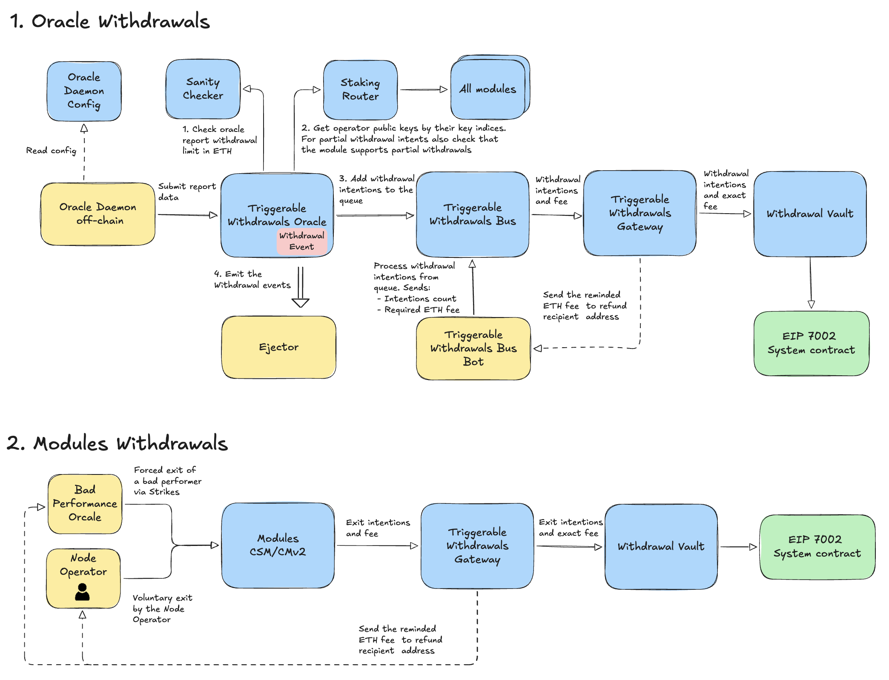
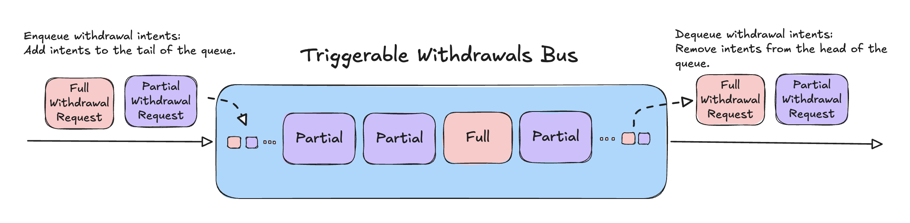

## Simple Summary

This proposal changes how the Lido protocol pulls stake back from validators. Instead of relying on Node Operators to pre-sign exit messages and run software to broadcast them, the protocol requests withdrawals directly from the withdrawal credentials contract using [EIP-7002](https://eips.ethereum.org/EIPS/eip-7002). Partial withdrawals are supported so that, in most cases, validators' balance can be reduced without a need for a full exit. Node Operators no longer need to maintain exit messages or run ejector software. Two now-unnecessary mechanisms are also removed: exit delay verification with late-exit penalties, and exit requests hash delivery via EasyTrack.

This proposal also introduces **Active Rebalancing**: a controlled, rate-limited way to move stake away from Curated Module v2 operators above their target share, instead of waiting for deposits and withdrawals to even it out.

## Abstract

We propose to rework the Validators Exit Bus Oracle (VEBO), on-chain and off-chain, so that it stops requesting exits through pre-signed exit messages and instead issues EIP-7002 withdrawal requests: partial withdrawal requests (PWRs) and full withdrawal requests (FWRs).

**On-chain**, we add a new **`TriggerableWithdrawalsBus` contract** that stores a **FIFO queue** of withdrawal request intents (partial and full), appended by the VEBO on each Oracle report. Anyone can call a public function on the queue to process requests in order and send them through the `TriggerableWithdrawalsGateway` (TWG) to the EIP-7002 predeploy. The proposal also removes two mechanisms of the Triggerable Withdrawals framework ([LIP-30](lip-30.md)) that the new flow makes redundant: exit delay verification with late-exit penalties, and exit requests hash delivery via EasyTrack.

**Off-chain**, we rework the exit-ordering logic so it selects both which validators to exit and the withdrawal amount per validator. This adds support for **partial withdrawal requests** — preferring PWRs against `0x02` validators and falling back to FWRs where PWRs are not applicable — and for **Active Rebalancing**: additional, rate-limited exits against CMv2 operators whose `currentStake` exceeds their `targetStake`, moving the module toward its target distribution.

## Motivation

### Limitations of the current VEBO

The current VEBO depends on Node Operators uploading pre-signed validator exit messages and on Ejector software to broadcast them. This mechanism has worked reliably since it went live with Lido V2, but the design has structural limits:

- **Full exits only.** The flow exclusively supports full validator exits.
- **Limited upload capacity.** Only a limited number of pre-signed exit messages can be uploaded for each Node Operator. This limits the harm if an operator's signing system is compromised, but also limits how many and which validators the Ejector can exit.
- **Operational overhead.** Every Node Operator must run and secure dedicated Ejector software, and the protocol must verify that they do.
- **Limited exit selection.** Because VEBO can request only specific pre-signed keys, it is hard to optimize the exit order, reduce sweep delay, or target an exact amount of stake.

### Why withdrawal-based exits

EIP-7002 lets the protocol trigger withdrawals from the execution layer using validators' `0x01` and `0x02` withdrawal credentials. Building the VEBO around PWRs and FWRs:

- Allows **precise stake exit** from `0x02` validators in CMv2 using partial withdrawals, leaving the validator active.
- **Eliminates unproductive stake time** — ETH keeps earning rewards right up until a withdrawal is processed, with no idle time behind a queued full exit waiting for the sweep to reach the exited validator.
- **Removes the need** for operators to maintain pre-signed exit messages and run dedicated Ejector software.
- Enables simple **full exits** via EIP-7002, without unpacking exit data from a VEBO report.

### Why active rebalancing

Today, stake redistribution across Node Operators and modules happens mostly through organic inflows (new deposits) and outflows (withdrawal demand). The two existing levers beyond this flow serve other purposes: the **boosted exit mode** of the operator target limit ([LIP-25](lip-25.md)) is a measure for offboarding an operator, and the **deposit reserve** ([LIP-35](lip-35.md)) is a static mechanism for guaranteeing a stable flow of deposits to a dedicated module, as with the CMv2 onboarding. Neither can pull an over-target CMv2 operator back toward its target stake on a controlled schedule. For CMv2 we need a mechanism that can deliberately move the module toward its target distribution while staying compatible with the regular withdrawal and deposit flow. The withdrawal-based VEBO flow makes such a mechanism natural to express: rebalancing is simply additional, rate-limited exit demand against over-target operators.

## Specification



### Overview

The diagram above shows the two paths by which withdrawal requests reach the EIP-7002 system contract. Both converge on the `TriggerableWithdrawalsGateway` (TWG) — the single entry point for every partial (PWR) or full (FWR) withdrawal request — and each caller (consumer) draws from its own pair of rate limits: a PWR limit in ETH and an FWR limit in validators; a batch that does not fit into the caller's remaining limits reverts as a whole. The TWG forwards each request with the exact EIP-7002 fee to the `WithdrawalVault`, which encodes it and submits it to the EIP-7002 system contract and refunds any unused fee to the caller-specified refund recipient.

With the transition to EIP-7002 usage for stake withdrawals, two mechanisms introduced by the [Triggerable Withdrawals](./lip-30.md) framework become redundant and are removed in this LIP: **exit delay verification with late-exit penalties** and **exit requests hash delivery via EasyTrack**. The Ejector can be used only for VEBO-requested FWRs (see [Deprecating the Ejector](#deprecating-the-ejector)).

#### Oracle withdrawals flow

1. **The off-chain Oracle computes withdrawal request intents.** The Oracle daemon reads its parameters from `OracleDaemonConfig` and builds the ordered list of withdrawal request intents — each a PWR against a `0x02` validator or an FWR — in three sequential phases:
    - Phase 1 — cover regular **withdrawal-queue demand**;
    - Phase 2 — issue **forced validator exits**;
    - Phase 3 — add **active rebalancing** within CMv2. Phase 3 is optional and can be switched off (leaving only Phases 1–2).
2. **The off-chain Oracle submits the report to the VEBO contract.** On submission, the VEBO:
    - checks the report's total requested withdrawal balance in ETH against the [sanity checker limit](#oraclereportsanitychecker), weighing each PWR at its `amount` and each FWR at the maximum effective balance of its module's WC type (32 ETH for `0x01`, 2048 ETH for `0x02`);
    - retrieves the validators' public keys from the modules via the `StakingRouter` using their key indices and, for every PWR, checks that the target module has `partialWithdrawalsAllowed` set;
    - appends the intents, in report order, to the single FIFO queue in the `TriggerableWithdrawalsBus` contract;
    - emits a `WithdrawalRequested` event per intent.
3. **Execute queued intents from `TriggerableWithdrawalsBus`.** An executor (the [Triggerable Withdrawals Bus Bot](#triggerable-withdrawals-bus-bot) or any other caller) calls the permissionless `processWithdrawalIntents`, passing the exact number of intents to process and the required EIP-7002 fee. The queue pops exactly that many intents from its head (the call reverts if the queue holds fewer), in order, and hands them with the fee to the TWG, which turns them into actual withdrawal requests. If the batch exceeds the remaining PWR or FWR limit of the VEBO consumer on the TWG, the whole call reverts and the intents stay at the head of the queue, so the executor must size the batch to fit both remaining limits.

### Rationale

#### Single FIFO queue



Withdrawal request intents (both PWRs and FWRs) are stored in a single FIFO queue and processed in submission order, each becoming an actual EIP-7002 withdrawal request only once executed. We chose this model because:

- **Simplicity.** One queue is simple to process on-chain and does not need separate concurrency controls.
- **Safety with public execution.** The strict execution order of withdrawal intents within the queue limits interference by public callers and removes the possibility of [FWR-replay DDoS](https://github.com/lidofinance/lido-improvement-proposals/blob/develop/LIPS/lip-30.md#61-attack-vector-vulnerability-from-uncontrolled-creation-of-twrs).

The trade-offs are:

- **No skipping.** Requests must run in order. A request that is no longer valid must still run before the queue can move forward. We do not add a skip function because it would add on-chain complexity. This assumption holds only while EIP-7002 fees are low.
- **No choice at execution time.** Because the order is fixed, the executor cannot optimize it later, for example to reduce FWR sweep delay. This is acceptable because CMv2 should mostly use PWRs. CSM instances (`0x01` and `0x02`) do not support PWRs because of their FIFO stake-distribution mechanism and the need for a key to remain fully bonded.
- **PWR/FWR concurrency.** PWRs and FWRs share the same EIP-7002 throughput. The VEBO manages this through ordering and batching. They can also conflict for one validator: a pending PWR blocks a later FWR, and the later request is rejected by the CL and must be sent again (see [Shared iterator mechanics](#shared-iterator-mechanics) and [Security Considerations](#security-considerations)).

#### Deprecating the Ejector

The Ejector cannot process PWRs, and the new system expects a few FWRs. Historical mainnet data shows that EIP-7002 fee spikes are short and end before VEBO can react. With fewer validators and no planned reduction in EIP-7002 throughput, request fees should remain reasonable. The Ejector can therefore be used for **FWRs only**: it may pick up FWR intents from `WithdrawalRequested` events (`amountGwei == 0`) and broadcast the operator's pre-signed exit message. PWRs are always executed through the `TriggerableWithdrawalsBus`.

#### Removing exit delay verification and late-exit penalties

Late-exit penalties exist because the exit is performed by the Node Operator, whose Ejector broadcasts a pre-signed exit message, and the protocol cannot know whether that happened without a CL state proof. With the proposed changes the protocol submits the withdrawal request through EIP-7002 and the consensus layer executes it with no action from the operator. Nothing can fail or be ignored on the operator side, so there is nothing to prove and no reason for a penalty.

#### Removing exit requests hash delivery via EasyTrack

The [`SubmitExitRequestHashes` EasyTrack factories](lip-30.md#appendix-b---easy-track-factories-for-veb) let Curated and sDVT Node Operators submit exit requests through VEBO's `submitExitRequestsHash` without Oracle quorum. They are primarily a safety net for operators who lose access to validator signing keys and therefore cannot sign a voluntary exit. This need disappears: **CMv1** is being consolidated into CMv2, and **sDVT** runs distributed validators, where losing the keys is unlikely, and is going to be deprecated in the near future as well.

**CSM and CMv2** trigger exits directly through the TWG and do not rely on this flow (see [Modules withdrawals flow](#modules-withdrawals-flow)).

With no consumer left, the hash-delivery entry points and the EasyTrack factories built on them can be safely removed.

#### Per-consumer PWR and FWR limits

We are updating the `TriggerableWithdrawalsGateway`. Its single global count-based limit is replaced with **per-consumer limits**: every caller — the VEBO path (via the `TriggerableWithdrawalsBus`) and each staking module's `Ejector` (CSM, CSM `0x02`, CMv2) — has its own quota, so one consumer cannot exhaust the budget of another. Each consumer's quota has **two independent parts**:

- **PWR limit, in ETH.** A PWR withdraws exactly `amountGwei`, so the stake it moves is known on-chain and the limit can bound it precisely.
- **FWR limit, in validators.** The stake an FWR moves is the validator's balance, which the TWG cannot see — it ranges from ~32 ETH (`0x01`) to 2048 ETH (`0x02`). Counting FWRs in validators avoids weighing every FWR at a worst-case 2048 ETH, which would overstate a `0x01` exit ~64× and let a few FWRs drain the budget for PWRs.

### Off-chain Oracle: ordering and rebalancing logic

Per report, the Oracle produces the ordered list of withdrawal request intents. It runs the exit-order iterator ([`exit_order_iterator.py`](https://github.com/lidofinance/lido-oracle/blob/f352b8552b717ebf8ecaf3bd0f5cf6785909ec17/src/services/exit_order_iterator.py#L106)) — generalized from "pick the next validators to fully exit" to "pick the next validators and the amount (PWR/FWR) to withdraw" — across **three sequential phases**, each with its own demand source.

#### Shared iterator mechanics

All three phases reuse the same machinery. It is driven by one governance-tunable parameter, stored in the `OracleDaemonConfig` smart contract so it can be changed without an Oracle release:

- **`EXIT_ITERATION_CHUNK`** (default **32 ETH**) — the fixed unit of demand the iterator allocates per step.

**Iteration granularity.** The iterator processes exit demand in fixed `EXIT_ITERATION_CHUNK` (32 ETH) steps. Each step gives one chunk of demand to the highest-ranked operator and one of its validators, then ranks again. This keeps the order balanced across operators. A chunk becomes a PWR of up to `EXIT_ITERATION_CHUNK` from a `0x02` validator, or an FWR.

**PWR vs. FWR selection.** The Oracle always prefers a PWR. A validator is **PWR-eligible** when its module has `partialWithdrawalsAllowed` set in the `StakingRouter` (CMv2) and its balance is **at least 33 ETH**, i.e. at least 1 ETH above `MIN_ACTIVATION_BALANCE` (32 ETH). If the highest-ranked Node Operator has a PWR-eligible validator, the step takes a partial withdrawal of `min(EXIT_ITERATION_CHUNK, balance − MIN_ACTIVATION_BALANCE)` from it, leaving the validator active. Only if the operator has **no** PWR-eligible validator does the Oracle issue an **FWR** for its oldest validator — the one with the lowest validator index. This is the last ranking predicate in every phase. More than one step can select the same validator in one report. These allocations are combined into one PWR intent, so the final PWR can be larger than `EXIT_ITERATION_CHUNK`.

**Forced exits are FWR-only.** Force-exit limits are counted in validators (`currentValidators − targetValidators`). Every request the iterator issues for an operator over its force-exit limit — in Phase 1 or Phase 2 — MUST therefore be an FWR, and the PWR preference above does not apply to it.

**No FWR over an unprocessed PWR.** The Oracle MUST NOT issue an FWR for a validator that has an in-flight PWR at any of these stages:

- queued in the **`TriggerableWithdrawalsBus`** FIFO queue (read via `getWithdrawalIntents`);
- queued in the **EIP-7002 system contract**, not yet dequeued to the CL (read from the contract's request queue storage);
- pending on the **CL**, in `state.pending_partial_withdrawals`.

It can use an FWR only in a later report, once no PWR for that validator is left at any of these stages. See [Security Considerations](#security-considerations).

A PWR added earlier in **this report** does not block an FWR. If a validator with no in-flight PWR is selected for an FWR after it already got PWR allocations in this report, the Oracle replaces its PWR intent with a single FWR intent, so the report never contains both a PWR and an FW R for the same validator.

**Exit-eligibility floor for freshly activated validators.** The CL silently drops any EIP-7002 withdrawal request — PWR or FWR — for a validator that has not yet been active for `SHARD_COMMITTEE_PERIOD` (256 epochs, ~27.3 hours) since its `activation_epoch`. The iterator MUST NOT select such a validator for withdrawal in any phase. This affects selection only: a validator still inside its `SHARD_COMMITTEE_PERIOD` window continues to count normally toward all stake and weight accounting.

**Per-report exit limit.** The iterator stops adding requests when the report's total exit balance (`max_current_exit_balance`) reaches the per-report [sanity checker limit](#oraclereportsanitychecker). All three phases share this limit. Requests are weighed with the **same formula as the on-chain sanity check** — `amount` for a PWR, and the maximum effective balance of the module's WC type for an FWR (32 ETH for `0x01`, 2048 ETH for `0x02`).

#### Income prediction

Phase 1 needs to know how much of the WQ demand will be covered without new requests. The Oracle predicts the ETH that will reach the EL up to a horizon `T` and requests withdrawals only for the remainder:

```
available(T) = elBalance                // EL rewards vault + WithdrawalVault + withdrawals reserve
             + liquidRewards(T)         // rewards that actually reach the EL by T
             + inFlight(T)              // already-requested withdrawals that land by T
             − depositLock(T)           // ETH expected to be consumed by new deposits

Phase 1 adds requests until  requested + available(T) ≥ unfinalizedStETH
```

`requested` counts each request at the ETH it brings in: `amount` for a PWR, and the validator's current **balance** for an FWR. If a validator has an FWR — in this report or in flight — its PWRs count **0**: the PWRs and the FWR together cannot bring in more than the validator's balance, and the FWR already counts all of it.

##### Liquid rewards

Only rewards that reach the EL by `T` (see [Prediction horizon](#prediction-horizon)) count. The historical rate is split into two components, both derived over `PREDICTION_DURATION_IN_SLOTS`:

- **EL rewards** — priority fees and MEV are paid to the EL rewards vault regardless of WC type, so they are always liquid. The rate is taken from `executionLayerRewardsWithdrawn` alone.
- **CL rewards** — normalized per unit of effective balance: `clRatePerEB = Σ(postCLBalance + withdrawalsWithdrawn − preCLBalance) / (timeElapsed × lidoEffectiveBalance)`. They count only for validators the CL sweep skims:
    - `0x01` validators — all CL rewards are skimmed;
    - `0x02` validators at the cap (`effective_balance == 2048 ETH`) — all CL rewards are skimmed;
    - `0x02` validators below the cap — CL rewards compound on the validator and contribute nothing.

```
liquidRewards(T) = elRate × T
                 + Σ_skimmed clRatePerEB × effective_balance × T
```

##### In-flight withdrawals

Withdrawals already requested in earlier reports MUST be counted. They come from four sources:

- **CL pending partial withdrawals** — Lido entries in `state.pending_partial_withdrawals`. They arrive after their `withdrawable_epoch`.
- **Unprocessed EIP-7002 requests** — Lido requests (`source_address` is the `WithdrawalVault`) still queued in the EIP-7002 system contract, not yet dequeued to the CL; read from the contract's request queue storage at the report's reference block. The CL dequeues them ahead of the `TriggerableWithdrawalsBus` intents, so their exit epoch is projected through the exit churn first, starting after the CL's current `earliest_exit_epoch`.
- **Unprocessed `TriggerableWithdrawalsBus` intents** — read via `getWithdrawalIntents`. Their exit epoch is projected through the exit churn, as for new requests, after the unprocessed EIP-7002 requests.
- **Lido validators with an exit already initiated on the CL** (`exit_epoch` set) — whether by a Lido request or a voluntary exit by the operator; slashed validators are not counted (see rule 2 below). They arrive after their `withdrawable_epoch`.

One validator can appear in more than one source, for example a queued FWR or PWR for a validator that was then slashed or exited voluntarily. `inFlight(T)` is therefore computed **per hm,validator**, counting each validator **once**, by the first rule that matches:
 bn
1. **Consolidation source** (`source_index` of an entry in `state.pending_consolidations`) — counts **0**. Its balance moves to the target validator, not to the `WithdrawalVault`. This matches the current Oracle, which excludes consolidation sources from withdrawable balance.
2. **Slashed** — counts **0** and never extends `T`. Its `withdrawable_epoch` is set at least `EPOCHS_PER_SLASHINGS_VECTOR` (8,192 epochs, ~36 days) after slashing, usually far beyond `T`, and its final balance depends on the not-yet-applied correlation penalty. Ignoring it only understates incoming ETH, so the Oracle errs toward requesting slightly more.
3. **Exit initiated, not slashed** (`exit_epoch` set) — **always** counts, at its **balance**. Its pending partials and queued intents add nothing: after `exit_epoch` is set, the CL ignores new withdrawal requests for the validator and processes its pending partials as 0.
4. **Queued FWR, no PWR pending on the CL** (FWR in the EIP-7002 system contract or the `TriggerableWithdrawalsBus`, and no entry for the validator in `state.pending_partial_withdrawals`) — counts at its current **balance**. Its queued PWRs count 0, since the FWR already counts the whole balance. A queued FWR for a validator that does have a PWR pending on the CL falls through to rule 5: the CL ignores an FWR while `pending_balance_to_withdraw > 0`, so only the PWRs are certain to deliver ETH.
5. **Otherwise** — the sum of its PWRs at every stage: pending on the CL (`state.pending_partial_withdrawals`), queued in the EIP-7002 system contract, and queued in the `TriggerableWithdrawalsBus`; capped at `balance − MIN_ACTIVATION_BALANCE`, as the CL applies them one by one against the remaining balance.

Validators under rules 3–5 always contribute, and their withdrawable epoch (actual, or projected for queued intents) extends `T` (see [Prediction horizon](#prediction-horizon)). Every rule picks the lower of the overlapping amounts, so `inFlight(T)` never overstates incoming ETH.

In-flight PWRs also reduce the validator's balance for selection: PWR eligibility (balance ≥ 33 ETH) and the PWR amount are evaluated on `balance − in-flight PWRs` of that validator.

##### Prediction horizon

Each request is assigned an expected arrival epoch on the EL. PWRs and FWRs consume the same CL exit churn (`compute_exit_epoch_and_update_churn`), so the churn is simulated over in-flight requests first and then over the requests of this report, in FIFO order. Both request types use the same formula:

```
arrival = exit_epoch + MIN_VALIDATOR_WITHDRAWABILITY_DELAY
```

The sweep delay (FWR) and the pending-partials drain delay (PWR) are intentionally ignored. Both only push arrival later, so ignoring them shortens `T` and lowers the predicted rewards. The prediction therefore errs toward requesting slightly more, never less.

The horizon `T` is the latest arrival epoch among the in-flight requests and the requests added to this report so far, excluding slashed validators (see [In-flight withdrawals](#in-flight-withdrawals)).

#### Phase 1 — Cover withdrawal-queue demand

Phase 1 covers the current **withdrawal-queue (WQ) demand**, preferring PWRs over full exits where possible. It stops once the ETH requested in this report plus the predicted available ETH covers the unfinalized stETH in the WQ (see [Income prediction](#income-prediction)). It walks that demand in `EXIT_ITERATION_CHUNK` steps, ranking validators at each step by, in order:

1. **Forced-exit deviation** — operators over a force-exit limit first, by how far `currentValidators − targetValidators` exceeds the threshold. While an operator is over its force-exit limit, its selected validators are always exited with an **FWR**, skipping predicates 5–6 (see [Forced exits are FWR-only](#shared-iterator-mechanics)).
2. **Soft-exit deviation** — same idea for soft-exit limits, after forced exits.
3. **Module share-rate deviation** — modules above their `priority_exit_share_threshold` (relative to total protocol balance) get elevated priority.
4. **Target-stake deviation** — operators furthest **above** their target stake exit first, where `targetStake = moduleStake × operatorWeight / moduleTotalWeight`. Operator weights come from [LIP-35](lip-35.md): read on-chain via `getOperatorWeights` for CMv2, aggregated via the Meta Registry for CMv1, and a uniform baseline weight elsewhere.
5. **Already-requested validators** — validators that already have PWR demand allocated to them **within this report** rank first, but only while their remaining balance stays PWR-eligible (at least 33 ETH). This concentrates exited balance into as few validators as possible, taking more balance from one validator before moving to the next.
6. **Smallest PWR-eligible validator** — among the operator's PWR-eligible validators, prefer the one with the **smallest balance that is greater than or equal to 33 ETH** and take a PWR from it. This leaves the validator active.
7. **Oldest validator (FWR)** — only if the operator has no PWR-eligible validator: the validator with the lowest validator index, exited with an FWR.

#### Phase 2 — Forced validator exits

After WQ demand is covered, the iterator satisfies any not-yet-fulfilled **forced-exit obligations**. Every Phase 2 request is an **FWR** (see [Forced exits are FWR-only](#shared-iterator-mechanics)).

1. **Forced-exit deviation** — operators over a force-exit limit first, by how far `currentValidators − targetValidators` exceeds the threshold.
2. **Lowest validator index** — within an operator, ascending validator index.

#### Phase 3 — Active rebalancing

This phase applies **only to the CMv2 staking module** and adds exit demand against operators drifting above their target stake, pushing the module back toward its target distribution.

**Data model.** Phase 3 (and Phase 1 criterion 4) uses the following definitions:

Rebalancing works **per CMv2 node operator id**, but measures stake and weight the same way the CMv2 deposit allocator does ([LIP-33 Meta Registry](lip-33.md#meta-operators-registry)), including each operator's share of its `OperatorGroup`'s external (CMv1) stake.

- **`operatorWeight`** — the operator's **effective** weight `ew_i = w_i × share_i / 10,000`, as returned by `getOperatorWeights` ([LIP-35](lip-35.md)).
- **`moduleTotalWeight`** — the sum of `operatorWeight` over operators participating in the calculation, **excluding** operators inside the grace period (see the grace period below).
- **`externalStake`** — the operator's share of its group's external stake, `es_i = totalExternalStake × ew_i / Σ ew_group`. `0` for an operator whose group has no external operators.
- **`currentStake`** — the operator's active CMv2 validator balance, after reserving all in-flight withdrawals, **plus** its `externalStake`. For a PWR, reserve its requested amount. For an FWR, reserve the validator's balance at `refSlot`. In-flight requests include FIFO queue entries and requests pending on the CL (`pending_partial_withdrawals` for PWRs).
- **`moduleStake`** — the sum of `currentStake` over participating operators, **excluding** operators inside the grace period.
- **`targetStake`** = `moduleStake × operatorWeight / moduleTotalWeight`.
- **Exit source.** External stake counts toward `currentStake`, but rebalancing exits only the operator's **CMv2** validators. If an operator's excess over `targetStake` is larger than its CMv2 stake, rebalancing can exit at most its CMv2 stake, and the rest of the excess stays.
- **Request types.** All CMv2 validators use `0x02` credentials; rebalancing prefers PWRs but **issues an FWR** for an operator that has no PWR-eligible validator (see [PWR vs. FWR selection](#shared-iterator-mechanics)).

| `OracleDaemonConfig` key                 | Type          | Meaning                                                                                                                                                   |
|------------------------------------------|---------------|-----------------------------------------------------------------------------------------------------------------------------------------------------------|
| `ACTIVE_REBALANCING_ENABLED`             | bool          | Global on/off for Phase 3.                                                                                                                                |
| `ACTIVE_REBALANCING_RATE_LIMIT`          | uint (ETH)    | Max stake that may exit for rebalancing in one VEBO report.                                                                                               |
| `ACTIVE_REBALANCING_OPERATOR_EXCESS_BP`  | uint (bp)     | Operator-level trigger: `currentStake` over `targetStake` as a share of `targetStake`.                                                                    |
| `ACTIVE_REBALANCING_MODULE_EXCESS_BP`    | uint (bp)     | Module-level trigger: the sum of over-target stake across all operators as a share of total module stake.                                                 |
| `ACTIVE_REBALANCING_GRACE_PERIOD_EPOCHS` | uint (epochs) | Epochs since the operator's first validator `activation_epoch` before it counts toward `moduleStake`/`moduleTotalWeight` and participates in rebalancing. |

All five keys are editable by the CM Committee ([CMC](lip-33.md#cmc)) via EasyTrack, without a full DAO vote per change (see [EasyTrack factories](#easytrack-factories)).

**Trigger.** Phase 3 requires `ACTIVE_REBALANCING_ENABLED` to be set, and runs when **one or more** of the following conditions holds:

1. **Operator-level** — at least one operator's `currentStake` exceeds `targetStake × (1 + ACTIVE_REBALANCING_OPERATOR_EXCESS_BP / 10,000)`;
2. **Module-level** — the sum of stake above target stake across all operators within the module exceeds a defined percentage of the total module stake.
   `Σ max(0, currentStake − targetStake) > moduleStake × ACTIVE_REBALANCING_MODULE_EXCESS_BP / 10,000`
   (summed over operators outside the grace period).

While neither condition holds, Phase 3 stays dormant, so small temporary differences do not create exit churn.

A **new-operator grace period** applies: an operator whose first validator was activated less than `ACTIVE_REBALANCING_GRACE_PERIOD_EPOCHS` ago is **excluded from the rebalancing calculation entirely** — its balance does not count toward `moduleStake`, its weight does not count toward `moduleTotalWeight`, and it is neither ranked nor targeted by rebalancing exits. Grace-period operators remain eligible to receive deposits via the normal deposit allocation.

**Activation epoch.** Every Oracle MUST derive the grace period from the same source, or reports diverge and no quorum forms. It is taken from the CL state at the report's `refSlot`:

```
firstActivationEpoch = min(validator.activation_epoch)   over the operator's deposited keys in state.validators
                                                          with activation_epoch ≤ refEpoch
inGracePeriod        = (refEpoch − firstActivationEpoch) < ACTIVE_REBALANCING_GRACE_PERIOD_EPOCHS
```

**Bounds.** The total rebalancing stake added to the report is capped at `ACTIVE_REBALANCING_RATE_LIMIT`, which weighs a PWR at its `amount` and an FWR at the validator's balance capped at its maximum effective balance. Rebalancing requests also count toward the remaining shared [per-report exit limit](#shared-iterator-mechanics). Rebalancing reduces excess stake; it does not guarantee that the withdrawn ETH is redeposited or that it reaches a specific under-target operator. That depends on future withdrawal demand, available buffer ETH, and the normal deposit-allocation rules.

**Ordering.** When it runs, the iterator ranks over-target CMv2 operators by, in order:

1. **Target-stake deviation** — node operators rank by the deviation `currentStake − targetStake`; the operator furthest **above** target ranks first.
2. **Already-requested validators** — validators with PWR demand already allocated **within this report** rank first, concentrating exited balance into as few validators as possible.
3. **Smallest PWR-eligible validator** — prefer the validator with the smallest balance that is greater than or equal to 33 ETH and take a PWR from it, so the validator stays active.
4. **Oldest validator (FWR)** — only if the operator has no PWR-eligible validator: the validator with the lowest validator index, exited with an FWR.

### On-chain withdrawal intents

#### ValidatorsExitBusOracle

The off-chain oracle daemon calls `submitReportData` with a `ReportData` structure whose `data` is a blob of fixed-width records packed together. The VEBO supports a **single report format**, so the `dataFormat` selector is removed from `ReportData` along with the format constants:

```solidity
struct ReportData {
    uint256 consensusVersion;
    uint256 refSlot;
    uint256 requestsCount;
    bytes   data;               // packed records, see below
}
```

Each record carries the withdrawal **amount**:

```
/// MSB <---------------------------------------------------LSB
/// |  3 bytes   |   5 bytes    |   8 bytes  |    8 bytes     |
/// |  moduleId  |  nodeOpId    |  keyIndex  |  amount (gwei) |
```

`amount` (uint64, gwei) — **new**; `0` = full withdrawal (FWR), `> 0` = partial withdrawal (PWR).

On submission the VEBO decodes each record into a `WithdrawalIntent` struct — a withdrawal request intent, not yet a real withdrawal request on the CL — and appends it to the `TriggerableWithdrawalsBus` via the role-gated `addWithdrawalIntents` call.

On `submitReportData`, the VEBO **MUST validate that every record with `amount > 0` (a PWR) targets a module with `partialWithdrawalsAllowed` set** in the `StakingRouter` (see [StakingRouter](#stakingrouter)); otherwise, the whole call reverts.

```solidity
interface IValidatorsExitBusOracle {
    /// Off-chain oracle daemon submits the ordered, packed report; each record is decoded into a
    /// WithdrawalIntent and appended to the TriggerableWithdrawalsBus FIFO.
    function submitReportData(ReportData calldata report, uint256 contractVersion) external;

    /// Emitted for every queued intent.
    event WithdrawalRequested(
        uint32  indexed moduleId,
        uint64  indexed nodeOperatorId,
        bytes   pubkey,
        uint64  amountGwei
    );
}
```

**Cutover.** The hash-delivery entry points `submitExitRequestsHash` and `submitExitRequestsData` are removed, and the `SUBMIT_REPORT_HASH_ROLE` held by EasyTrack is revoked. Legacy report hashes with exit data not yet delivered at the moment of the upgrade are **abandoned** — the new format cannot deliver them, and no legacy delivery path is retained. The underlying exit demand re-emerges organically from validator balances and is re-covered by subsequent VEBO reports.

#### TriggerableWithdrawalsBus

**New upgradable contract** deployed behind an [`OssifiableProxy`](https://github.com/lidofinance/core/blob/master/contracts/0.8.9/proxy/OssifiableProxy.sol), with the proxy admin set to the Aragon Agent. The queue holds state that must survive changes to the contract logic: intents queued but not yet processed, and the queue head and tail pointers.

It stores the single FIFO queue of withdrawal request intents and exposes the full queue surface:

- **`addWithdrawalIntents`** — role-gated append; the VEBO is the only expected role holder, adding decoded report records to the tail of the queue in report order.
- **`processWithdrawalIntents`** — the permissionless execution entry point: pops exactly `count` intents from the head of the queue and executes them down the TWG → WithdrawalVault → EIP-7002 path, with the caller forwarding the per-request fee and naming a refund recipient for the unused remainder. If the queue holds fewer than `count` intents, the call reverts. If the popped intents exceed the remaining PWR or FWR limit of the VEBO consumer on the TWG, the whole call reverts and the queue is left unchanged.
- **`unprocessedIntentsCount` / `getWithdrawalIntents`** — views that let permissionless executors and monitoring tools inspect the queue before processing it; `getWithdrawalIntents` pages through the queued intents in execution order.

```solidity
interface ITriggerableWithdrawalsBus {
    /// A single queued withdrawal request intent — not yet an EIP-7002 request.
    /// amount == 0  -> full withdrawal (FWR) once executed; counts as one validator
    ///                 against the TWG's FWR limit.
    /// amount  > 0  -> partial withdrawal (PWR) once executed; counts at amount
    ///                 against the TWG's PWR limit.
    struct WithdrawalIntent {
        uint64  amount;         // gwei; 0 = full withdrawal (FWR), > 0 = partial withdrawal (PWR).
        bytes   pubkey;         // validator pubkey
    }

    /// Called by the VEBO: append decoded report intents to the tail of the
    /// FIFO queue. Role-gated; the VEBO is the only expected holder of the role.
    function addWithdrawalIntents(WithdrawalIntent[] calldata intents) external;

    /// Permissionless — pop exactly `count` queued intents and execute each as an
    /// actual withdrawal request down the EIP-7002 path (TWG -> WithdrawalVault -> predeploy).
    /// Caller forwards the per-request fee; unused fee is refunded to `refundRecipient`.
    /// Reverts if the queue holds fewer than `count` intents, or if the batch exceeds
    /// the remaining TWG limits of the VEBO consumer.
    function processWithdrawalIntents(uint256 count, address refundRecipient) external payable;

    /// Number of intents waiting in the FIFO queue.
    function unprocessedIntentsCount() external view returns (uint256);

    /// Returns up to `limit` queued intents starting from position `offset` in execution order.
    /// `offset == 0` is the next intent `processWithdrawalIntents` will execute.
    function getWithdrawalIntents(uint256 offset, uint256 limit) external view returns (WithdrawalIntent[] memory);
}
```

The queue offers no dismissal or reordering surface — requests execute strictly in submission order (see [Single FIFO queue](#single-fifo-queue)).

**Cost model.** The `processWithdrawalIntents` caller pays EIP-7002 fees for all VEBO-path requests. The forced-exit fee refund mechanism is removed.

#### TriggerableWithdrawalsGateway (TWG)

**Unified request path.** The TWG becomes the single entry point for **all** withdrawal requests — partial and full. A new `triggerWithdrawals` method carrying a per-request `amount` (`0` = FWR, `> 0` = PWR) is added, and the existing full-exit-only **`triggerFullWithdrawals` is removed**. Its current consumers — the CSM `Ejector` (`voluntaryEject` and strikes-based ejection via `ValidatorStrikes._ejectByStrikes`) — migrate to `triggerWithdrawals`:

```solidity
interface ITriggerableWithdrawalsGateway {
    struct WithdrawalIntent {
        uint64  amount;         // gwei; 0 = full withdrawal (FWR), > 0 = partial withdrawal (PWR).
        bytes   pubkey;         // dynamic type placed last, consistent with the queue's WithdrawalIntent
    }

    /// Processes all `intents` in order; reverts if they exceed the caller's remaining
    /// PWR limit (sum of PWR amounts) or FWR limit (number of FWRs) (no partial processing).
    /// Forwards each intent to the WithdrawalVault with the exact EIP-7002 fee and
    /// refunds any unused fee to `refundRecipient`.
    function triggerWithdrawals(
        WithdrawalIntent[] calldata intents,
        address refundRecipient
    ) external payable;
}
```

All callers go through this single entry point, and each draws from **its own** PWR and FWR limits (see the rate limiter below).

As part of this, it **drops `_notifyStakingModules`**: the current TWG calls back into staking modules whenever it triggers an exit, via the Staking Router's `onValidatorExitTriggered`, which in turn calls the module's `onValidatorExitTriggered`. This callback existed to support late-exit-penalty accounting, which is removed in this release. Exits triggered through the TWG no longer notify staking modules, so any module-side logic hanging off that notification stops firing.

**Rate limiter.** The single global count-based limit (`maxExitRequestsLimit`, `exitsPerFrame`, `frameDurationInSec`, measured in validator exits) is replaced with **per-consumer limits**. A consumer is the immediate caller of `triggerWithdrawals` (`msg.sender`): the `TriggerableWithdrawalsBus` for the VEBO path, and the `Ejector` of each staking module. Every consumer has two independent quotas with the same restoring-quota mechanics as today ([LIP-30, Appendix A](lip-30.md#appendix-a--limit-implementation)):

- **PWR limit** — denominated in ETH (gwei). Each PWR consumes its `amountGwei`.
- **FWR limit** — denominated in validators. Each FWR consumes one unit, whatever the validator's balance or WC type.

The setter and getter are replaced:

```solidity
interface ITriggerableWithdrawalsGateway {
    struct LimitConfig {
        uint256 maxLimit;            // maximum quota that can be accumulated
        uint256 limitPerFrame;       // quota restored per frame
        uint256 frameDurationInSec;  // frame duration, in seconds
    }

    struct LimitInfo {
        uint256 maxLimit;
        uint256 limitPerFrame;
        uint256 frameDurationInSec;
        uint256 prevLimit;
        uint256 currentLimit;        // remaining quota; 0 if the limit is not set
    }

    /// Gated by TW_EXIT_LIMIT_MANAGER_ROLE.
    /// @param consumer Caller address the limits apply to.
    /// @param pwrLimit PWR quota, in gwei.
    /// @param fwrLimit FWR quota, in validators.
    function setConsumerLimits(
        address consumer,
        LimitConfig calldata pwrLimit,
        LimitConfig calldata fwrLimit
    ) external;

    function getConsumerLimitsFullInfo(address consumer) external view returns (
        LimitInfo memory pwrLimit,   // gwei
        LimitInfo memory fwrLimit    // validators
    );
}
```

`setExitRequestLimit` and `getExitRequestLimitFullInfo` are removed. The values stored in the global limit cannot be reinterpreted, so the upgrade MUST call `setConsumerLimits` for every consumer listed in [Initial limits](#initial-limits).

Four rules apply:

1. **Separate quotas.** A call consumes the sum of its PWR `amount`s from the caller's PWR quota and the number of its FWRs from the caller's FWR quota. Consumers never share quota.
2. **Unset means zero.** A consumer without configured limits has zero quota, so any non-empty call from it reverts. A zero PWR limit disables PWRs for that consumer.
3. **Max limit floors.** For every consumer that has a non-zero limit, the PWR `maxLimit` MUST be ≥ 2048 ETH and the FWR `maxLimit` MUST be ≥ 1 validator, so a single request of either type always fits once the quota has fully restored, and the FIFO can never jam permanently on its head intent.
4. **Revert on exhaustion.** If a batch exceeds either remaining quota of the caller, the TWG reverts the whole transaction; there is no partial processing. Callers must size their batches to fit both remaining quotas.

##### Initial limits

The upgrade sets the following limits.

- **VEBO.** The limits are sized against the [per-report sanity limit](#oraclereportsanitychecker) of 19,200 ETH. The PWR `maxLimit` equals the most one report can carry: 19,200 ETH for a report made entirely of PWRs. The FWR `maxLimit` is 500 validators — the maximum number of validators a single VEBO report can carry, capped by the `OracleDaemonConfig` setting. A report made entirely of FWRs therefore always fits. The restore rates (32 ETH per 48 s and 5 validators per 288 s) restore 19,200 ETH and 500 validators — one full report of either kind — every 8 hours, the VEBO report period (75 epochs).
- **Modules.** Modules trigger **FWRs only**: their `Ejector` paths (`voluntaryEject` and strikes-based ejection) are full-exit only, and PWRs for module validators go through the VEBO. Their PWR limit is therefore **0**, so the TWG rejects any PWR from a module path. FWR limits are lower for `0x02` modules, whose validators can hold up to 2048 ETH each.

| Consumer (`msg.sender`)            | WC type | PWR `maxLimit`          | PWR restore   | FWR `maxLimit`   | FWR restore         |
|------------------------------------|---------|-------------------------|---------------|------------------|---------------------|
| VEBO (`TriggerableWithdrawalsBus`) | mixed   | 19,200 ETH              | 32 ETH / 48 s | 500 validators   | 5 validators / 288 s |
| CSM (`Ejector`)                    | `0x01`  | 0 (PWRs disabled)       | —             | 500 validators   | 1 validator / 192 s |
| CSM `0x02` (`Ejector`)             | `0x02`  | 0 (PWRs disabled)       | —             | 150 validators   | 1 validator / 384 s |
| CMv2 (`Ejector`)                   | `0x02`  | 0 (PWRs disabled)       | —             | 150 validators   | 1 validator / 384 s |

All non-zero limits satisfy the max limit floors. Any later change to a consumer's limits, including enabling PWRs for a module, requires a DAO vote.

#### StakingRouter

A new `partialWithdrawalsAllowed` field is added to `ModuleStateConfig` — whether the VEBO may accept PWRs for the module. It is `true` for CMv2 and `false` for all other modules, including CSM `0x02`. The setter is gated by `STAKING_MODULE_MANAGE_ROLE`; setting `true` requires `withdrawalCredentialsType == 0x02`.

```solidity
struct ModuleStateConfig {
    /// Other fields skipped for brevity ...

    uint8 withdrawalCredentialsType;
    /// Whether partial withdrawal requests (PWRs) are allowed for this module's validators.
    bool partialWithdrawalsAllowed; // new; uses one of the two reserved bytes, the struct stays in one slot
}

function setStakingModulePartialWithdrawalsAllowed(uint256 _stakingModuleId, bool _allowed) external;
```

The two exit-related hooks are removed:

- **`onValidatorExitTriggered`** — the TWG no longer notifies modules on exit, so this callback (and its module-interface counterpart) is deleted.
- **`reportValidatorExitDelay`** — the entry point through which the `ValidatorExitDelayVerifier` reported proven exit delays for penalty accounting; with penalties gone, nothing calls it.

Removing the hooks orphans their access-control grants, so the upgrade vote MUST also **revoke the corresponding roles**: `REPORT_VALIDATOR_EXIT_TRIGGERED_ROLE` from the TWG and `REPORT_VALIDATOR_EXITING_STATUS_ROLE` from the `ValidatorExitDelayVerifier`.

#### Staking Modules (NOR, SDVT, CSM, CMv2)

It is proposed to keep the legacy **NOR** and **SDVT** modules unchanged.

For **CSM** and **CMv2**, it is proposed to:
* **Switch the `TriggerableWithdrawalsGateway` call** from `triggerFullWithdrawals` to `triggerWithdrawals`.
* **Remove `onValidatorExitTriggered` implementations** together with the EIP-7002 fee charge-back they drive — the hook becomes unreachable once the TWG stops notifying staking modules about validator exits.
* **Remove late-exit-penalty accounting** — the bookkeeping driven by `reportValidatorExitDelay`, including tracking proven exit delays and applying the corresponding penalties, since `StakingRouter.reportValidatorExitDelay` is removed.
* **Remove `isValidatorExitDelayPenaltyApplicable` and `exitDeadlineThreshold`** — the remaining `IStakingModule` methods of the exit-penalty system.

#### ValidatorExitDelayVerifier

**Removed entirely.** This contract verifies a CL state proof that a validator requested to exit is still active, computes how long the operator has been eligible to exit it, and reports the delay through `StakingRouter.reportValidatorExitDelay`. Once late-exit penalties are removed there is nothing to prove or report, so the contract and its `LidoLocator` registration are deleted. The off-chain Validator Late Prover Bot that produced these proofs is retired with it.

#### WithdrawalVault

The WithdrawalVault already supports EIP-7002 partial withdrawals (variable `amount`), so it needs no functional change. A new implementation is deployed with the new TWG as its authorized caller (an immutable constructor parameter).

#### LidoLocator

Register the new TWG address and the `TriggerableWithdrawalsBus` proxy address so the rest of the protocol resolves them after the upgrade, and **remove the `ValidatorExitDelayVerifier` entry**.

#### OracleDaemonConfig

This release **adds the following keys** to the contract: the iterator parameter shared by all modules (see [Shared iterator mechanics](#shared-iterator-mechanics)), and CMv2's five Phase 3 active-rebalancing keys (see [Phase 3 — Active rebalancing](#phase-3--active-rebalancing) for their meaning and defaults):

| Key                                      | Type          | Default | Meaning                                                                                                                                                   |
|------------------------------------------|---------------|---------|-----------------------------------------------------------------------------------------------------------------------------------------------------------|
| `EXIT_ITERATION_CHUNK`                   | uint (ETH)    | 32      | Fixed unit of demand the iterator allocates per step.                                                                                                     |
| `ACTIVE_REBALANCING_ENABLED`             | bool          | —       | Global on/off for Phase 3.                                                                                                                                |
| `ACTIVE_REBALANCING_RATE_LIMIT`          | uint (ETH)    | —       | Max stake that may exit for rebalancing in one VEBO report.                                                                                               |
| `ACTIVE_REBALANCING_OPERATOR_EXCESS_BP`  | uint (bp)     | —       | Operator-level trigger: `currentStake` over `targetStake` as a share of `targetStake`.                                                                    |
| `ACTIVE_REBALANCING_MODULE_EXCESS_BP`    | uint (bp)     | —       | Module-level trigger: the sum of over-target stake across all operators as a share of total module stake.                                                 |
| `ACTIVE_REBALANCING_GRACE_PERIOD_EPOCHS` | uint (epochs) | —       | Epochs since the operator's first validator `activation_epoch` before it counts toward `moduleStake`/`moduleTotalWeight` and participates in rebalancing. |

#### EasyTrack factories

The EasyTrack factories that submit exit request hashes to VEBO on behalf of Curated and sDVT Node Operators are **removed** in this release, and their `SUBMIT_REPORT_HASH_ROLE` is revoked. They depend on the hash-delivery flow, which the VEBO no longer has (see [Rationale](#removing-exit-requests-hash-delivery-via-easytrack)).

A new EasyTrack factory is **added**: it lets the CM Committee ([CMC](lip-33.md#cmc)) update the five `ACTIVE_REBALANCING_*` keys on `OracleDaemonConfig` (see [`OracleDaemonConfig`](#oracledaemonconfig)) without a full DAO vote per change.

- **Trusted caller** — the CMC multisig.
- **Allowed keys** — the factory MUST reject any key other than the five `ACTIVE_REBALANCING_*` keys. `OracleDaemonConfig` gates all keys behind a single `CONFIG_MANAGER_ROLE`, so the factory's key allowlist is the only thing that stops the CMC from changing other Oracle parameters.
- **Role** — the EasyTrack `EVMScriptExecutor` is granted `CONFIG_MANAGER_ROLE` on `OracleDaemonConfig`.
- **Initial values** — the keys are set by the DAO vote that enacts this LIP. The factory only updates existing keys.
- **Value validation** — the factory MUST validate every value set by the CMC against the rules below and reject the motion otherwise. Changing the bounds themselves requires a DAO vote.

| Key                                      | Type          | Allowed values    | Notes                                                                                                    |
|------------------------------------------|---------------|-------------------|----------------------------------------------------------------------------------------------------------|
| `ACTIVE_REBALANCING_ENABLED`             | bool          | `true` / `false`  | No bound; the CMC can switch Phase 3 on and off.                                                         |
| `ACTIVE_REBALANCING_RATE_LIMIT`          | uint (ETH)    | TBD ≤ value ≤ TBD | Upper bound caps how much stake rebalancing can exit per report.                                         |
| `ACTIVE_REBALANCING_OPERATOR_EXCESS_BP`  | uint (bp)     | TBD ≤ value ≤ TBD | Lower bound keeps small deviations from triggering rebalancing.                                          |
| `ACTIVE_REBALANCING_MODULE_EXCESS_BP`    | uint (bp)     | TBD ≤ value ≤ TBD | Lower bound keeps small deviations from triggering rebalancing.                                          |
| `ACTIVE_REBALANCING_GRACE_PERIOD_EPOCHS` | uint (epochs) | TBD ≤ value ≤ TBD | Lower bound protects newly onboarded operators; upper bound limits how long an operator can stay exempt. |

### Triggerable Withdrawals Bus Bot

It is proposed to develop a new off-chain bot that monitors the `TriggerableWithdrawalsBus` and processes withdrawal intents as soon as they appear in the queue:

- **Rate-limit aware.** Before each call, the bot reads the VEBO consumer's remaining TWG limits (`getConsumerLimitsFullInfo` for the `TriggerableWithdrawalsBus` address) and sets `count` so that both the sum of the batch's PWR amounts and the number of its FWRs fit into them (see the [rate limiter rules](#triggerablewithdrawalsgateway-twg)).
- **Fee-capped.** The bot processes intents only while the EIP-7002 request fee is below the maximum fee set in its config. During a fee spike it pauses and resumes once the fee drops, so short-term spikes delay execution instead of increasing its cost.

The bot is a convenience, not a trust assumption: `processWithdrawalIntents` stays permissionless, so anyone can process the queue at the current fee while the bot is paused or offline.

## Security Considerations

- **Interference / DDoS by public callers.** The single FIFO queue keeps request order fixed by the Oracle report and avoids the FWR-replay attack surface.
- **PWR/FWR concurrency for one validator.** The CL rejects an FWR while the validator has an unprocessed PWR. The FWR fee is lost and the request must be sent again. **The VEBO MUST NOT issue an FWR for a validator that has an in-flight PWR** — in the `TriggerableWithdrawalsBus` queue, in the EIP-7002 system contract queue, or in the CL `pending_partial_withdrawals` (see [No FWR over an unprocessed PWR](#shared-iterator-mechanics)). It may use an FWR only after the PWR has cleared all of them. A PWR from the same report is instead replaced by the FWR. The VEBO MUST never select a validator that already has an in-flight FWR.
- **PWRs to non-PWR modules.** A PWR for a CSM `0x02` validator cannot be dismissed once queued, and its effect on CSM stake and bond accounting would be hard to unwind. The VEBO therefore enforces `partialWithdrawalsAllowed` on-chain instead of relying on the off-chain Oracle.
- **Per-consumer TWG limits.** Each consumer has its own quota, so a compromised or malfunctioning module `Ejector` can exhaust only its own limits and cannot block VEBO-path withdrawals or another module's ejections. The PWR limit, in ETH, caps how much stake partial withdrawals can move per frame. The FWR limit is counted in validators, so the stake it bounds depends on the consumer's WC type: up to ~32 ETH per FWR for `0x01` validators and up to 2048 ETH per FWR for `0x02` validators. The limits for `0x02` consumers are set lower in validator terms to account for this (see [Initial limits](#initial-limits)). Module consumers get a zero PWR limit, so the TWG itself rejects PWRs from module paths. The max-limit floors guarantee the VEBO queue always advances: the head intent fits once the corresponding quota has fully restored.
- **EIP-7002 fee risk.** Modeling of normal usage shows that high fees are unlikely at realistic batch sizes. Short-term spikes are absorbed by the Triggerable Withdrawals Bus Bot's maximum-fee threshold. See [EIP-7002 Partial Withdrawal Economics](https://hackmd.io/G82dyK7lQZWmO9vYNJ7fjA?view#EIP-7002-Fee-Dynamics).
- **Migration safety.** The explicit `ACTIVE_REBALANCING_ENABLED` switch ensures active rebalancing cannot interfere with migration sequencing.
- **Grace period.** Excluding new operators from the rebalancing calculation entirely (no contribution to `moduleStake`/`moduleTotalWeight`, not ranked, not targeted) prevents them from inducing immediate rebalancing pressure right after onboarding. Residual risk: a drained operator can re-register under a fresh identity and re-receive stake through normal deposit allocation while immune to rebalancing for the grace window; this is bounded by CMv2 bond requirements and `ACTIVE_REBALANCING_RATE_LIMIT`.

## Failure Modes

- **Short EIP-7002 fee spike** — the Triggerable Withdrawals Bus Bot pauses while the fee is above its configured maximum and resumes once it drops; queued intents wait, delaying WQ fulfillment. Anyone can still process the queue at the current fee.
- **Sustained EIP-7002 fee spike** — the Triggerable Withdrawals Bus Bot stays paused and queued intents wait for the duration of the spike, delaying WQ fulfillment. Mitigation: monitor execution-layer withdrawal-request fees and, if the delay becomes unacceptable, process the queue at the current fee (the call is permissionless) or raise the bot's maximum fee.
- **TWG limit exhausted** — calls from the consumer whose PWR or FWR limit is exhausted revert until that quota restores. For the VEBO path, `processWithdrawalIntents` reverts and queued intents stay at the head of the queue; because the queue is FIFO, an exhausted FWR limit also holds back PWRs queued behind the head FWR (and vice versa). Other consumers are unaffected, since every consumer has its own limits.
- **No-op requests** (a validator is already exiting, slashed, or is otherwise unaffected) — there is **no dismissal mechanism**. Every queued request MUST still be executed before the FIFO can advance, even when the CL will not apply it.

## Copyright

Copyright and related rights waived via [CC0](https://creativecommons.org/publicdomain/zero/1.0/).

<!-- my monkey

   w  c(..)o w
    \__(-)__/
       /\
      /  \
     w   w

-->
