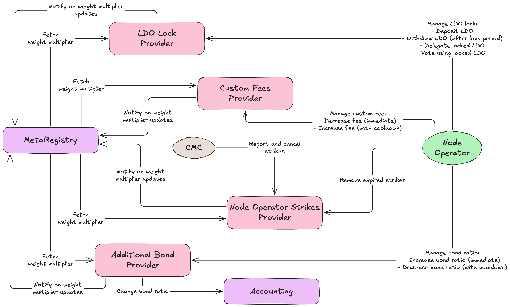
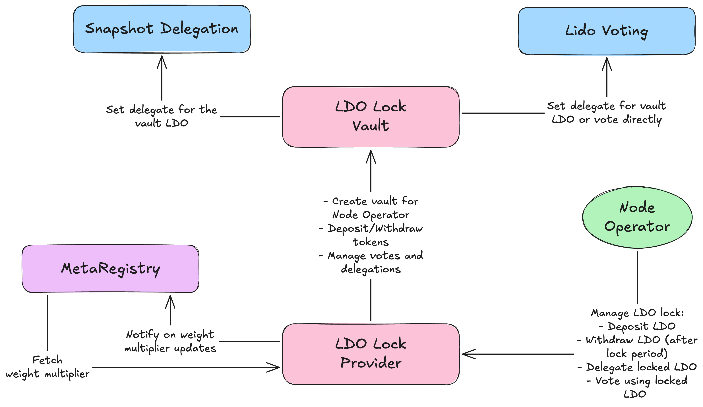
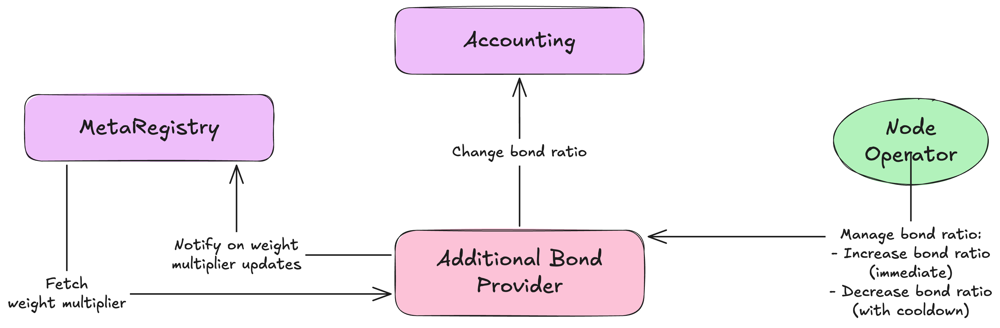
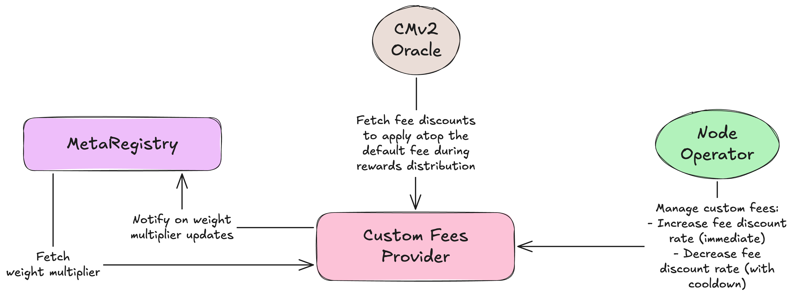
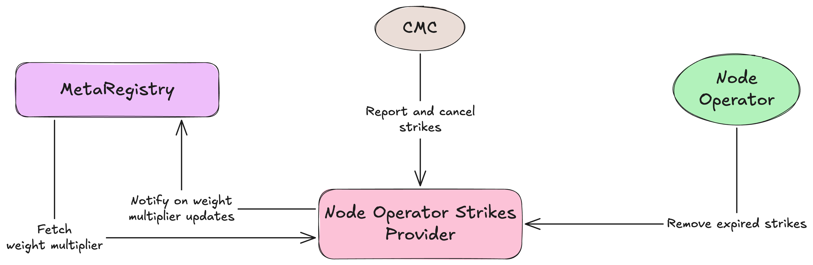
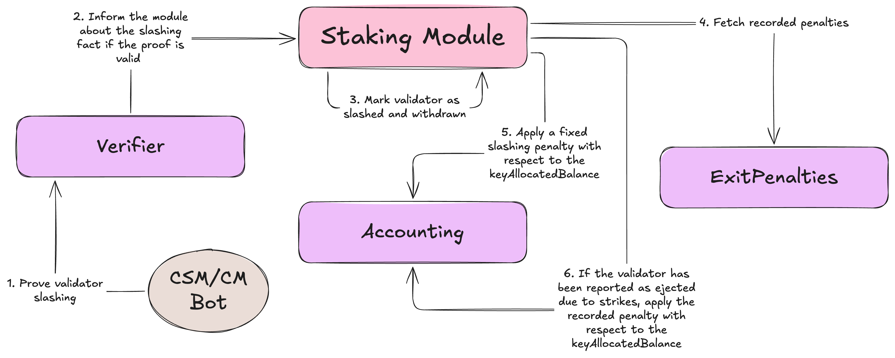

# LIP-42. Curated Module v2 Phase 2. ValMart

## Simple Summary

[Curated Module v2](./lip-33.md) (CMv2) has laid the foundation for the next phase of the Lido protocol's evolution. The stake allocation mechanism in CMv2 already supports weight-based stake allocation. The missing piece is the way for the Node Operators to influence their stake allocation weight. CMv2 Phase 2 closes this gap with the introduction of the Validator Market (ValMart). The ability to set custom fee values, increase the bonding ratio, lock LDO tokens, and the Node Operator strike system are key components of ValMart. Node Operators can increase their stake allocation weight by offering more favorable conditions to the Lido protocol. At the same time, CMC, the party responsible for overseeing the Curated Module, will have the ability to issue Node Operator Strikes in case of underperformance or other violations of the standard node operator protocols (SNOPs), consequently reducing the stake allocation weight of the Node Operator. The combination of these mechanisms aims to foster a competitive landscape that encourages Node Operators to optimize their service offerings and maintain high performance standards for the Lido protocol.

Alongside ValMart, several technical and operational improvements are proposed for both CMv2 and CSM.

## Motivation

Since the very inception of the Lido protocol, the Node Operators have been the backbone of its operations. Their performance and reliability directly impact the protocol's efficiency and security. However, the current system lacks a mechanism for Node Operators to actively influence their stake allocation weight based on their performance and offerings. This limitation has led to a level playing field with even stake distribution and minimal differentiation based on performance, where Node Operators have little incentive to innovate or improve their services.  

ValMart is aimed at improving both protocol economics and the overall performance of the Lido network by creating a competitive environment for Node Operators, incentivizing them to offer better conditions and maintain high standards of operation.

## Introduction

This LIP covers new contracts and flows added with ValMart to CMv2, and additional improvements to CSM and CMv2 not directly related to ValMart. Contracts architecture, flows, permissions, upgradability, and security considerations remain unchanged compared to [LIP-33](./lip-33.md) unless explicitly stated otherwise.

## Specification

- [Project repo](https://github.com/lidofinance/staking-modules)
- Written in [Solidity 0.8.33](https://github.com/ethereum/solidity/tree/v0.8.33)
- Developed in [Foundry](https://github.com/foundry-rs/foundry)

> Terms validator, key, validator key, and deposit data meanings are the same within the document

### ValMart

General architecture of CMv2 is covered in [LIP-33](./lip-33.md). Here we focus on the specific changes and additions introduced in ValMart.

All ValMart features listed below are applicable to CMv2 only.

#### Weight Boost Providers

The key component of ValMart's architecture is the concept of weight boost providers. Weight boost providers are responsible for determining the weight multiplier of each Node Operator based on various factors. These weights are then used to calculate the overall stake allocation weight of the Node Operator within the protocol.

##### Weight Calculation Mechanism

The total weight of a Node Operator is calculated as the product of its base weight and all applicable weight multipliers:

$$
TotalWeight = BaseWeight_{Type} \times \prod_{i \in PerNodeOperator} M_i(NO) \times \prod_{j \in MaxPerGroup} \max_{k \in Group} M_j(k)
$$

where $M_i(k)$ is the weight multiplier returned by provider $i$ for Node Operator $k$.

MetaRegistry triggers a recalculation of this total weight under two scenarios:

- Provider-driven changes: A provider notifies MetaRegistry of a change (e.g., a change in bonding ratio or LDO lock status).
- Base-weight changes: A change to the Node Operator's base weight (e.g., a change in Node Operator type).

In either case, MetaRegistry fetches the most recent multipliers from all active providers to ensure an accurate total weight.

##### Adding and Removing Weight Boost Providers

Weight boost providers are added to `MetaRegistry` via `addWeightBoostProvider(address provider, WeightBoostProviderMode mode)` and removed via `removeWeightBoostProvider(address provider)` by the DAO via `DEFAULT_ADMIN_ROLE`. Once a provider is removed, its multipliers are no longer used in weight calculations.

Each provider is registered in one of two modes:

- `PerNodeOperator` - the multiplier returned by the provider for the Node Operator is applied to this Node Operator only.
- `MaxPerGroup` - the largest multiplier returned by the provider across all Node Operators in the Node Operator Group is applied to every Node Operator in the group (see [LDO Lock Provider](#ldo-lock-provider-erc20lockboostprovidersol)).

Adding or removing a provider, as well as changing the provider's multiplier configuration, affects the weights of all Node Operators. Hence, these actions require a full recalculation of the Node Operators' weights. Until the recalculation is completed via the permissionless `batchDepositInfoUpdate` method on `CuratedModule`, initial deposits and top-ups to CMv2 are not possible.

#### LDO Lock Provider (`ERC20LockBoostProvider.sol`)

Node Operators can lock their LDO tokens to indicate alignment with the protocol's long-term interests.

Depositing LDO starts a lock period during which the tokens cannot be withdrawn. Additional deposits restart the lock period. Once the lock period ends, the tokens can be unlocked and withdrawn by the Node Operator. Withdrawals do not restart the lock period. If the Node Operator has no active and depositable keys, the lock period is ignored, and LDO tokens can be withdrawn immediately.

Lock period duration is configurable and determined by the DAO via `DEFAULT_ADMIN_ROLE`.

Deposited LDO tokens are held on the Node Operator's vault (`LidoGovernanceLockVault.sol`) created upon first deposit and can be used in the protocol's governance. Delegation on both Aragon Voting and Snapshot voting is supported. It is also possible to vote on Aragon proposals directly.

Unlike other providers that provide weight boost for the exact Node Operator, LDO Lock Provider provides weight boost for all Node Operators in the Node Operator Group the Node Operator belongs to. This design decision is motivated by the fact that, unlike other providers, LDO lock does not have any direct impact on the particular Node Operator in the group, and rather indicates overall alignment of the group owner with the goals and values of the Lido DAO. If several operators in the same group weight boost from the LDO Lock provider, the largest boost is used to avoid situations of stacked boosts from the same provider.

Weight multiplier is defined based on the current amount of LDO tokens deposited by the Node Operator to the vault. The weight multiplier values are set for ranges of LDO token amounts. The number of ranges and corresponding weight multipliers are determined by the DAO via `DEFAULT_ADMIN_ROLE`.

Example:

| LDO Amount Deposited      | Weight Multiplier |
|---------------------------|-------------------|
| Less than X LDO           | 1x                |
| From X to less than Y LDO | Mx                |
| From Y LDO and above      | Nx                |

It is assumed that 0 < X < Y and 1 < M < N.

#### Additional Bond Provider (`AdditionalBondRegistry.sol`)

Node Operators can increase their bonding ratio for their validators to improve bond coverage and protocol security.
  
Bonding ratio is the multiplier applied to the base bond requirements determined by the Node Operator's bond curve. Increasing this multiplier means that Node Operators need to have more bond for their already uploaded and future validator keys. The default bonding ratio is 1x, meaning that the default bond requirements are applied.

Node Operators can increase their bonding ratio at any time with the immediate effect on their stake allocation weight. Node Operators should have sufficient bond to cover the increased bonding ratio. Increased bonding ratio is applied immediately and reflected in `Accounting` contract.

Decreasing bond ratio comes with the cooldown period. Once the decrease of the bonding ratio compared to the current value is requested, stake allocation weight is reduced immediately, while the bonding ratio remains the same until the cooldown period elapses. Once the cooldown period elapses, Node Operators have to submit an additional transaction to apply the reduced bonding ratio in the `Accounting` contract. This approach ensures that Node Operators can not immediately reduce their bonding ratio and withdraw bond in case of a detected slashing or low performance incident.

Cooldown duration is configurable and determined by the DAO via `DEFAULT_ADMIN_ROLE`.

An additional bond provider is attached to the `Accounting` contract via `SET_BOND_CURVE_MULTIPLIER_ROLE`.

Weight multiplier is defined based on the current bonding ratio set or requested by the Node Operator. The weight multiplier values are set for ranges of bonding ratios. The number of ranges and corresponding weight multipliers are determined by the DAO via `DEFAULT_ADMIN_ROLE`.

Example:

| Bonding Ratio              | Weight Multiplier |
|----------------------------|-------------------|
| From 1x to less than Qx    | 1x                |
| From Qx to less than Rx    | Mx                |
| From Rx and above          | Nx                |

It is assumed that 1 < Q < R and 1 < M < N.

#### Custom Fee Provider (`CustomFeeRegistry.sol`)

Node Operators can set the custom fee they are willing to operate at. Lower fees increase the Lido DAO revenue. Hence, setting a lower fee (relative to the default fee for the given Node Operator type) results in higher stake allocation weight for the Node Operator.

The fee discount does not change the module fee minted by `StakingRouter`, and hence does not affect stETH holders. The part of the Node Operator's rewards forgone due to the discount is not distributed to the Node Operator. Instead, it is transferred to the Lido DAO treasury by `FeeDistributor` as a part of the rebate (see `rebateRecipient`), in the same way as the rewards not distributed due to the variable Node Operator reward share.

Custom fee set as the percentage discount from the default fee defined for the Node Operator type. Ex. 10% discount when default fee is 5% results in a custom fee of 4.5%, while for the default fee of 3% a 10% discount results in a custom fee of 2.7%. The bigger the discount, the higher the stake allocation weight for the Node Operator.

Node Operators can increase their fee discount at any time, which will immediately affect their stake allocation weight, and the effective fee will be used at the next Oracle report.

Decreasing the fee discount is subject to a cooldown period. Once the decrease of the fee discount compared to the current value is requested, stake allocation weight is reduced immediately, while the effective fee remains the same until the cooldown period elapses. Once the cooldown period elapses, Node Operators have to submit an additional transaction to apply the reduced fee discount. This approach ensures that Node Operators cannot immediately reduce their fee discount and gain an unfair advantage in stake allocation since fees are effective as of Oracle reports (currently every 14 days).

Cooldown duration is configurable and determined by the DAO via `DEFAULT_ADMIN_ROLE`.

CMv2 Oracle uses active fee discounts set by Node Operators as of the report's `refSlot`. That indirectly means that the discount reduction cooldown period should be at least as long as the interval between Oracle reports to prevent Node Operators from bypassing the cooldown by timing their discount reductions around Oracle reports.

Weight multiplier is defined based on the current fee discount set or requested by the Node Operator. The weight multiplier values are set for ranges of fee discounts. The number of ranges and corresponding weight multipliers are determined by the DAO via `DEFAULT_ADMIN_ROLE`.

Example:

| Fee Discount          | Weight Multiplier |
|-----------------------|-------------------|
| From 0% to Q%         | 1x                |
| From (Q+1)% to R%     | Mx                |
| From (R+1)% and above | Nx                |

It is assumed that 0 < Q < R, 1 < M < N, and Q and R are integers.

#### Node Operator Strikes Provider (`NodeOperatorStrikes.sol`)

Poor performance, standard node operator protocol (SNOP) violations, and other misbehavior by Node Operators should have a clear reflection in their stake allocation weight. Node Operator Strikes Provider is the way to achieve this accountability. Weight multipliers in this provider are below 1 and decrease as the number of active strikes increases. This effectively means that more strikes leads to a decrease in the total stake allocation weight for the Node Operator.

The overseeing party (likely CMC - Curated Module Committee) can issue strikes to Node Operators and remove already issued strikes via `STRIKES_COMMITTEE_ROLE`. Each strike is an independent record that comes with the category, description, and lifetime. Category and description provide context for the strike, while the lifetime determines how long the strike affects the Node Operator's stake allocation weight.

Expired strikes are not removed automatically and keep affecting the stake allocation weight until removed. Once a strike has expired, anyone (typically the Node Operator) can remove all expired strikes of the Node Operator in a single transaction via the permissionless `removeExpiredStrikes` method, restoring the stake allocation weight.

Weight multiplier is defined based on the current number of active strikes for the Node Operator. The weight multiplier values are set for ranges of strike counts. The number of ranges and corresponding weight multipliers are determined by the DAO via `DEFAULT_ADMIN_ROLE`.

Example:

| Active Strikes     | Weight Multiplier |
|--------------------|-------------------|
| From 0 to Q        | 1x                |
| From Q+1 to R      | Mx                |
| From R+1 and above | Nx                |

It is assumed that 0 ≤ Q < R and 1 > M > N ≥ 0. A multiplier of 0 excludes the Node Operator from stake allocation.

### Non-ValMart changes

#### Transition from Easy Track-settled to immediate automatic slashing penalties

> This feature applies to both CMv2 and CSM.

Since [LIP-33](./lip-33.md) implementation, slashing penalties in CMv2 and CSM are [applied via Easy Track motions](./lip-33.md#slashed-validators) initiated by CMC and CSMC respectively. While offering maximal precision in slashing penalty calculation, this approach introduces delays and additional operational overhead.

It is proposed to replace the current Easy Track-based slashing penalty mechanism with an immediate automatic slashing penalty system. Once a validator is marked as slashed on CL, a permissionless proof can be delivered to the staking module. Upon delivery, a fixed penalty is applied immediately ensuring timely compensation of the approximate projected losses for stETH holders. Base value for the penalty is set per Node Operator type (new parameter in `ParametersRegistry` contract) upon contracts deployment and can be changed by the DAO later. To ensure fair penalization, `keyAllocatedBalance` is used to scale base penalty according to the amount of stake allocated to the particular validator key.

The base penalty is calibrated to cover the direct losses of an isolated slashing and the missed rewards until the validator becomes withdrawable under normal exit queue conditions, using a `2048 ETH` validator as a reference, and is scaled linearly to the balance of the slashed validator. Additional losses, such as correlation penalties or missed rewards due to a longer withdrawal delay, are expected to be reported in a form of a [General Delayed Penalty](./lip-33.md#general-penalty-with-confirmation) if needed. Since the settlement of the General Delayed Penalty is Easy Track gated, the trust assumptions for these additional losses remain unchanged compared to the LIP-33 approach. The fixed penalty itself, in turn, is applied automatically upon a permissionless proof without an Easy Track motion, and is bounded by the DAO-set parameter.

To ensure that CMC and CSMC have sufficient time to determine and report additional losses, the Node Operator cannot claim any excess bond, including staking rewards and fee split payouts, until 14 days after the slashed validator's `withdrawable_epoch`. If several slashed validators are reported for the same Node Operator, the furthest of these deadlines applies, so a later report can extend the restriction but never shorten it.

In CMv2, while bond claims are blocked, the Node Operator is also excluded from top-up allocation. Otherwise, the removal of the slashed validator's stake from the Node Operator's balance would increase its allocation imbalance and direct top-ups to the Node Operator that was just slashed. Initial `32 ETH` deposits remain unaffected since their impact on stake allocation is minimal.

The other benefit of the proposed system is that it allows both CMv2 and CSM to enforce the fixed part of the slashing penalty even in the absence of the committees, making both modules more resilient and reducing reliance on committee actions for timely penalty enforcement compared to the current Easy Track-based approach. Additional losses still require CMC or CSMC to report a General Delayed Penalty.

#### Late Exit Penalty Deprecation

> This feature applies to both CMv2 and CSM.

[LIP-38](./lip-38.md) introduces a new approach to validator exits and partial withdrawals. Post-LIP-38 exits are performed via [EIP-7002](https://eips.ethereum.org/EIPS/eip-7002) and do not require any action from the Node Operator side. Hence, late exit penalty mechanism becomes obsolete and should be removed.

The following methods and flows will be removed:
- `BaseModule.sol`
    - `reportValidatorExitDelay` - Method for reporting delayed validator exits.
    - `onValidatorExitTriggered` - Hook to notify module about Triggerable Withdrawal (TW) fee paid.
- `ExitPenalties.sol`
    - `processExitDelayReport`
    - `processTriggeredExit`
    - `isValidatorExitDelayPenaltyApplicable`

`ExitPenalties.sol` sole responsibility post LIP-42 is to handle validator strike ejection penalties.

#### New balance tracking mechanism for CMv2

> This feature applies to CMv2 only. CSM keeps the mechanism covered in [LIP-33](./lip-33.md).

Partial withdrawals introduced in [LIP-38](./lip-38.md) make current ever-increasing per-validator balance accounting system insufficient, necessitating a new balance tracking mechanism for CMv2 with support for balance decreases.

The solution is to transition to a balance-checkpoint system. `keyConfirmedBalance` is deprecated. New `lastAccountingProofSlot` variable is introduced. `keyAllocatedBalance` is now updated according to the following rules:

- Top-up allocations increase `keyAllocatedBalance` immediately without recording `lastAccountingProofSlot` since it takes time for the deposit to be applied on CL.
- Balance proof from CL can only increase `keyAllocatedBalance` and update `lastAccountingProofSlot`. Proofs with `BeaconState.balances[validatorIndex]` below the current value of `keyAllocatedBalance` are ignored and do not affect the checkpoint.
- Partial withdrawal proof updates `keyAllocatedBalance` (with possible decrease) to the `BeaconState.balances[validatorIndex]` at the proof slot and updates `lastAccountingProofSlot`.
- Proofs for the validators marked as withdrawn are rejected.

Balance increases due to incoming consolidations are reported using ordinary balance proofs. 

Outgoing consolidations and full withdrawals are considered terminal event in the validator lifecycle. Once reported, current value of `keyAllocatedBalance + 32 ETH` is subtracted from the operator's and module's balances. No future updates to `keyAllocatedBalance` are expected after this point.

More details in a [separate document](https://hackmd.io/@lido/new-balance-tracking-for-cmv2).

#### Exit balance deficit penalty removal for CMv2

> This feature applies to CMv2 only. CSM keeps the mechanism covered in [LIP-33](./lip-33.md).

Due to the transition to the new balance tracking mechanism in CMv2, the exit balance deficit penalty is removed. The new mechanism does not guarantee a reliable snapshot of the validator's balance. Hence, exit balance deficit can not be calculated reliably.

Since CMv2 already assumes an overseeing committee (CMC) for reliable operation, it is assumed that a balance deficit that occurred due to validator underperformance is penalized manually using [General Delayed Penalty mechanism](./lip-33.md#general-penalty-with-confirmation). Balance deficit due to slashing is already handled using [dedicated Easy Track flow](./lip-33.md#slashed-validators).

#### Updated `Verifier` contract for CMv2 to support partial withdrawals and new balance tracking mechanism

> This feature applies to CMv2 only. CSM keeps the version of `Verifier` covered in [LIP-33](./lip-33.md).

Due to significant changes in the balance tracking mechanism, CMv2 will have it's own version of the `Verifier` contract called `CuratedVerifier` featuring the following methods:

##### `processSlashedProof`

This method is identical to the LIP-33 version.

##### `processValidatorWithdrawnProof`

Unlike LIP-33 `processWithdrawalProof`, this method does not require a proof of the full withdrawal event from the CL. Instead, it only requires a proof that the validator's `withdrawable_epoch` has been reached. The actual withdrawal event is no longer required due to the removal of the exit balance deficit penalty.

This method reports a terminal event in the validator's lifecycle to `CuratedModule` for validators that have exited or were consolidated.

##### `processBalanceProof`

This method is similar to the LIP-33 version, with the only difference being that it now updates the `keyAllocatedBalance` and `lastAccountingProofSlot` on `CuratedModule` to reflect the new balance and the slot of the proof, respectively.

##### `processPartialWithdrawalProof`

Allows reporting partial withdrawal proofs from the CL. The withdrawal event is considered a partial withdrawal if:

- Validator's withdrawal epoch is ahead of the current epoch.
- `BeaconState.balances[validatorIndex]` at the proof slot is below `MAX_EFFECTIVE_BALANCE`.

Once reported, `keyAllocatedBalance` is updated to reflect the new balance, and `lastAccountingProofSlot` is set to the slot of the proof.

##### `processHistoricalPartialWithdrawalProof`

This method is the version of `processPartialWithdrawalProof` that handles historical proofs, allowing reporting of partial withdrawals that occurred in the past.

##### Note on the historical versions of methods

The only historical method is `processHistoricalPartialWithdrawalProof`. Other methods do not need historical versions due to:

- `processSlashedProof` - once slashed, a validator remains slashed forever, and any future state of this validator can be used.
- `processValidatorWithdrawnProof` - once `withdrawable_epoch` is set for the given validator, we can be sure that the validator will eventually be withdrawn, and any future state of this validator can be used.
- `processBalanceProof` - due to the fact that `CuratedModule` accepts balance reports with the increased balance for the slots newer than `lastAccountingProofSlot`, and features no high-water mark mechanism, historical versions are unnecessary.

#### Proof-based exit accounting

> This feature applies to both CMv2 and CSM (0x01 and 0x02).

The exited validator counters stored in the modules (`totalExitedKeys` and `totalExitedValidators`) are currently delivered by the Accounting Oracle via `updateExitedValidatorsCount` and are not used in the modules' internal accounting. The modules recognize that a validator has left the active set only upon the withdrawal report, although the exit is observable on CL long before the withdrawal is swept.

It is proposed to replace the Oracle-delivered exited counters with proof-based exit accounting. Once an exit is initiated for the validator on CL (`exit_epoch != FAR_FUTURE_EPOCH`), a permissionless proof can be delivered to the staking module via the `Verifier` contracts (a new method is added to both `CuratedVerifier` for CMv2 and `Verifier` for CSM) calling a new `reportValidatorExited` method on the module. Upon delivery, the following changes are applied:

- The key is marked as exited. The per-key `isValidatorWithdrawn` flag is replaced by a storage-compatible `keyStatus` field (`NONE`, `WITHDRAWN`, `EXITED`) to support this. A withdrawal report still counts the exit if no exit proof was delivered before it.
- `totalExitedKeys` and `totalExitedValidators` counters are increased. `updateExitedValidatorsCount` and `unsafeUpdateValidatorsCount` called by `StakingRouter` become no-ops to ensure that neither the Oracle nor the DAO correction path can overwrite the proof-based values. Both methods remain a part of the `IStakingModule` interface, and the correction of the exited validators count stored in `StakingRouter` keeps working as before. During the upgrade, the counters are seeded from the withdrawn ones for all module instances (including the legacy 0x01 CSM). Exit proofs are expected to be delivered for all these instances. For the legacy CSM, the proof delay is negligible since 0x01 validators are swept shortly after the exit.
- The stake and the extra balance of the key are subtracted from the operator's and module's balances upon the exit report instead of the withdrawal one.

Keys marked as exited can not receive new top-ups: the per-key top-up limits are zeroed for the keys with `keyStatus != NONE`, hence, a key delivered by `StakingRouter` after its exit was proven receives no allocation. In CSM, the zeroed limit also allows removing the exited key's item from the top-up queue on the next depositor pass. Until then, the item occupies a queue slot and can temporarily throttle initial deposits.

Target limits, including the forced target limit applied to the Node Operators with unbonded keys, count active keys as `totalDepositedKeys - totalExitedKeys`. Hence, exited keys stop counting towards the target limit upon the exit report instead of the withdrawal one.

Similar to other proofs of the irreversible validator states, no historical version of the new method is needed: once `exit_epoch` is set for the given validator, it can not be unset, and any future state of this validator can be used.

In case of a missing or delayed exit proof, the module falls back to the current behavior (the key is accounted as active until the withdrawal report). Hence, the change can not make the accounting worse than it is today.

#### Exit-aware top-up allocation for CMv2

> This feature applies to CMv2 only. 0x02 CSM distributes top-ups strictly following its top-up queue, but exposes the same `getTopUpCapacity` view to `StakingRouter`.

Top-up capacity of CMv2 and its Node Operators is currently calculated as `totalDepositedKeys - totalWithdrawnKeys`. A validator that has initiated an exit shouldn't receive top-ups, yet it is removed from the capacity only once the withdrawal proof is delivered.

It is proposed to calculate the top-up capacity as `totalDepositedKeys - totalExitedKeys` using the proof-based exit accounting described above, both on the module level and for each Node Operator in the allocation algorithm. The operator-level top-up shares are tightened as well: the stake of an exited key is subtracted from the operator's balance upon the exit report, hence, Node Operators with exiting validators stop attracting top-up ETH they can not place. A new `getTopUpCapacity` view is introduced to expose the module capacity to `StakingRouter` for top-up allocation in place of the current `activeCount`-based estimation.

In case of a missing or delayed exit proof, the module falls back to the current behavior (capacity is freed upon the withdrawal report). Hence, the change can not make the allocation worse than it is today.

The [top-up allocation switch](./lip-33.md#top-up-allocation-switch) introduced in LIP-33 is kept. Although exit-aware top-up capacity removes the need for the switch in the case of exited validators, the switch remains useful for the cases of Node Operator offboarding and infrastructure incidents. It allows a Node Operator to stop receiving top-ups, while CMC decides when the top-up allocation can be resumed.

#### Intra-module consolidations for CMv2

> This feature applies to CMv2 only. CSM does not support validator consolidations.

Events like Node Operator infra compromise, mutual acquisitions, or simple sunset of the business are increasingly common and require stake re-allocation between Node Operators, which, in turn, poses significant challenges in terms of missed rewards if done via exit and re-entry of validators. The most common case is distribution of the stake controlled by a single Node Operator among multiple Node Operators. Re-allocations of this type can be efficiently handled through intra-module consolidations within CMv2, avoiding the need for costly exits and re-entries.

A new `ConsolidationController` contract is introduced to manage intra-module consolidations within CMv2. CMC holds the power to allow and disallow (by default, all operators are disallowed from submitting consolidation requests) a particular Node Operator to submit consolidation batches with the source validators belonging to this Node Operator and target validators being CMv2 validators controlled by the same or other Node Operators. The right to submit consolidation batches is reserved by the Node Operator Owner (see `getNodeOperatorOwner` method on `BaseModule.sol`). Node Operator Owner can also set an additional address authorized to submit consolidation batches on its behalf. Submitted batches are validated and forwarded to [`ConsolidationBus`](./lip-35.md#consolidation-message-bus) for scheduling and further execution. Upon submission, `ConsolidationController` ensures that:

- the source Node Operator is allowed by CMC to submit consolidation batches;
- the batch is submitted by the source Node Operator Owner or the address authorized by it;
- the source keys belong to the source Node Operator;
- the target keys belong to CMv2 Node Operators;
- all keys involved were deposited by Lido.

In essence, `ConsolidationController` acts similarly to [`ConsolidationMigrator`](./lip-35.md#consolidation-migrator) introduced in LIP-35 but for consolidations within CMv2.

### Upgradability

`ERC20LockBoostProvider.sol`, `AdditionalBondRegistry.sol`, `CustomFeeRegistry.sol`, `NodeOperatorStrikes.sol` are upgradable using [OssifiableProxy](https://github.com/lidofinance/staking-modules/blob/main/src/lib/proxy/OssifiableProxy.sol) contracts.

Instances of `LidoGovernanceLockVault.sol` are deployed using [BeaconProxy](https://github.com/OpenZeppelin/openzeppelin-contracts/blob/v5.4.0/contracts/proxy/beacon/BeaconProxy.sol) and share the same DAO-controlled [Beacon](https://github.com/OpenZeppelin/openzeppelin-contracts/blob/v5.4.0/contracts/proxy/beacon/UpgradeableBeacon.sol).

### Security Considerations

#### Blocking deposits to a Node Operator via strikes

CMC can block a Node Operator from receiving deposits by issuing an excessive number of strikes. Since the stake allocation weight also determines the Node Operator's target stake, excessive strikes can also lead to the withdrawal of the Node Operator's existing stake via active rebalancing (see [LIP-38](./lip-38.md)). This risk is accepted. CMC is expected to issue strikes only within its determined mandate.

### Known Issues

[LIP-33](./lip-33.md) mentions ["Permissionless withdrawal reporting vulnerability"](./lip-33.md#permissionless-withdrawal-reporting-vulnerability). This issue is no longer applicable to CMv2 due to the removal of the penalty applied upon validator exit and calculated based on the recorded validator balance. This penalty was initially introduced in CSM, a highly autonomous and permissionless staking module. CMv2, in turn, assumes a dedicated overseeing committee (CMC) responsible for monitoring the module's performance and acting accordingly (reporting general delayed penalties for cases of poor performance, see [snapshot vote](https://snapshot.org/#/s:lido-snapshot.eth/proposal/0xa4179234377bab093a8ee46da0f430d51bb343d00ca74ce8bf1d7d8cdb0db9dd)). Hence, the vulnerable mechanism is no longer needed in CMv2 and is removed in this LIP.

#### Race condition in `keyAllocatedBalance` updates between top-ups and partial withdrawals

A top-up is recorded immediately but may not yet be reflected on the consensus layer. If an earlier partial-withdrawal proof arrives during this window, its checkpoint replaces the tracked balance and temporarily excludes the pending top-up from `keyAllocatedBalance`. A newer proof restores it once the deposit is applied.

The current design prioritizes temporary underestimation, which may allow for some additional deposits. This is a deliberate choice to avoid a more severe failure mode. If we were to advance the `lastAccountingProofSlot` immediately during a top-up, the system would reject valid partial-withdrawal proofs because they would appear to be from an old slot. This would lead to an overestimated allocation, which would ultimately and unnecessarily restrict user deposits.

## Links

- [LIP-33. Community Staking Module v3 and Curated Module v2](https://github.com/lidofinance/lido-improvement-proposals/blob/develop/LIPS/lip-33.md)
- [LIP-29. Community Staking Module v2](https://github.com/lidofinance/lido-improvement-proposals/blob/develop/LIPS/lip-29.md)
- [LIP-26. Community Staking Module](https://github.com/lidofinance/lido-improvement-proposals/blob/develop/LIPS/lip-26.md)
